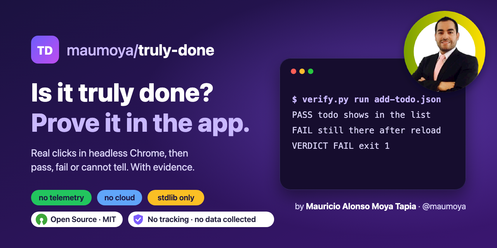
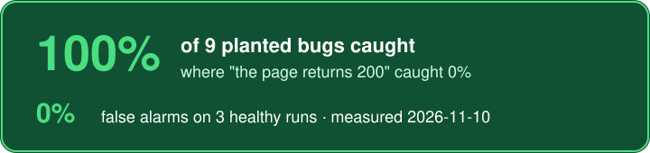
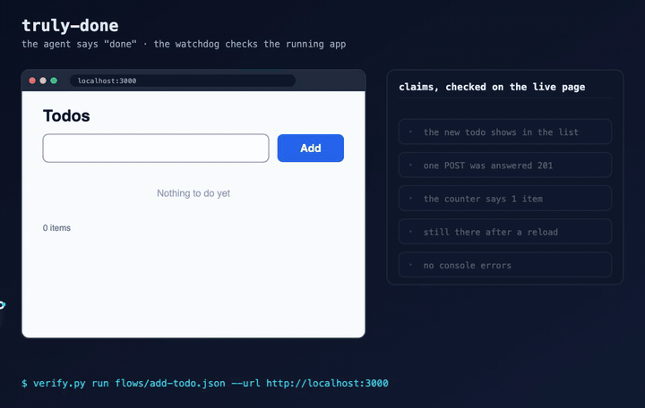

<!-- Badge row: regenerate with skill-forger-e2e's badges.sh. Numbers live in launch/facts.json (sync.py). -->
<p align="center">
  
</p>

<p align="center">
  
  <a href="#results-measured-2026-11-10"></a>
  
  <a href="https://opensource.org/license/mit"></a>
  
  <a href="https://scorecard.dev/viewer/?uri=github.com/maumoya/truly-done"></a>
  <a href="https://www.bestpractices.dev/projects/16524"></a>
</p>

<p align="center">
  <a href="#results-measured-2026-11-10"></a>
</p>

<p align="center">
  
</p>

# Truly Done

**Your AI agent says "done". Truly Done checks the running app and answers pass, fail or cannot tell.**

Truly Done is the "is it truly done?" check for AI coding agents: end-to-end browser verification for Claude Code,
Codex, Cursor and Gemini CLI, and a GitHub Action that gates a pull request on the real, running web app.

"The code compiles" and "the page returns 200" do not mean the feature works. Truly Done is a skill for Claude Code
and other coding agents that opens your own running web app in headless Chrome, does what a user would do (real
clicks, real typing), and checks each claim against the live page: the text on screen, counts, field values, the
URL, console errors and network calls. Every answer comes with the evidence line and a screenshot.

It runs on your machine only. No telemetry, no cloud, no account, no background service, no edits to your agent
or editor settings. Python standard library plus the Chrome you already have.

## Install

Claude Code plugin:

```
/plugin marketplace add maumoya/truly-done
/plugin install truly-done@truly-done
```

Any agent (Claude Code, Codex, Cursor, Gemini CLI):

```
npx skills add maumoya/truly-done
```

Needs Python 3.9+ and an installed Chrome or Chromium. No pip packages.

## Use

Say `/truly-done`, or ask in plain words:

- "Verify it works in the running app before you say done."
- "Did my fix actually work? Check the add-to-cart button on my dev server."
- "Add a todo, reload, and prove it is still there."

The agent looks at the page, writes a small flow file, and runs it. You can run the same thing by hand:

```
python3 skills/truly-done/scripts/verify.py snapshot localhost:3000
python3 skills/truly-done/scripts/verify.py run examples/add-todo.json --url localhost:3000
```

A flow is the steps a user takes and the claims that must hold. This is a short form of
[examples/add-todo.json](examples/add-todo.json); the full format is in
[flows.md](skills/truly-done/references/flows.md):

```json
{
  "name": "add a todo",
  "url": "/",
  "steps": [
    {"do": "type", "target": {"label": "New todo"}, "text": "Buy milk"},
    {"do": "click", "target": {"role": "button", "text": "Add"}},
    {"do": "expect", "expect": "text", "value": "Buy milk", "within": "#list", "claim": "the new todo shows in the list"},
    {"do": "expect", "expect": "request", "method": "POST", "url_matches": "/api/todos$", "status": 201, "times": 1, "claim": "one POST was answered 201"},
    {"do": "reload"}
  ],
  "claims": [
    {"expect": "text", "value": "Buy milk", "within": "#list", "claim": "the todo is still there after a reload"},
    {"expect": "no_console_errors"},
    {"expect": "no_failed_requests"}
  ]
}
```

The run prints every claim and one verdict line, and writes `truly-done-report/<flow>/` with `report.md`,
`report.json` and `final.png`. Real output on an app that forgets the item after a reload:

```
  PASS        the new todo shows in the list
  PASS        one POST was answered 201
  FAIL        the todo is still there after a reload  <- text 'Buy milk' is not on the page
  PASS        no console errors
  PASS        no failed requests
VERDICT FAIL  add a todo  (5 claims, 9.5 s)  the todo is still there after a reload: text 'Buy milk' is not on the page
```

| Verdict | Exit code | Meaning |
|---|---|---|
| `PASS` | 0 | every step ran and every claim held |
| `FAIL` | 1 | the app is broken: a claim did not hold, or a real click could not reach its target |
| `CANNOT TELL` | 2 | the check could not decide (app not running, target missing or ambiguous). Never counted as a pass |

### In CI (GitHub Action)

Start your app in the job, then gate the pull request on the real thing:

```yaml
- run: npm start &
- uses: maumoya/truly-done@v0.1.0
  with:
    flows: flows/*.json
    url: 127.0.0.1:3000
```

The step fails on `FAIL` and on `CANNOT TELL` (set `allow-unknown: true` to let the second one through).

### Guard rails (enforced in code, not only in the prompt)

- **Loopback by default.** Any other host is refused unless you pass `--mine` to say the app is yours.
- **Writes stay home.** POST, PUT, PATCH and DELETE to any origin other than the app under test are blocked
  unless `--allow-origin` names it. `--offline` blocks every request to another origin.
- **Nothing leaves.** No usage data, no update check, no account, no cloud. There is no code path that sends
  anything to the author.
- **No footprint.** A new empty browser profile per run, deleted afterwards. No daemon, no config edits.
- **Secrets stay out.** A value typed from `{"env": "NAME"}` is redacted in every report.
- **Real clicks only.** A covered or disabled button fails the step; it is never clicked through script.
- **Stays on your app.** A `goto` step to any other site is refused, and a URL that cannot be parsed is refused, not guessed.

## Results (measured 2026-11-10)

A fixture todo app with 9 planted bugs and 3 healthy variants, each checked two ways: the usual "the page
answers 200" check, and one Truly Done flow.

| Check | Planted bugs caught (of 9) | False alarms (of 3 healthy) |
|---|---|---|
| HTTP 200 on the page | <!--fact:baseline_caught-->0%<!--/fact--> | 0% |
| Truly Done flow | <!--fact:bugs_caught-->100%<!--/fact--> | <!--fact:false_alarms-->0%<!--/fact--> |

Median time per flow: <!--fact:median_seconds-->9.6 s<!--/fact-->. The planted bugs: the button does nothing, an
invisible layer covers the button, the button is disabled, the API fails while the page shows the item, the item is gone after a reload,
the write is sent twice, the input is not cleared, the counter is wrong, a console error on click.

Run it yourself: `python3 bench/run.py` (raw rows in [bench/results/2026-11-10.json](bench/results/2026-11-10.json)).

**Does the skill change what the agent does?** Three eval cases, 3 runs each, with the skill and without it
(`claude plugin eval`, claude 2.1.319; block in [evals/bench/2026-11-10.md](evals/bench/2026-11-10.md)):

| Case | Passed with the skill | Passed without |
|---|---:|---:|
| Write a correct flow from a plain-English ask | 3/3 | 0/3 |
| Do not say "done" when the report says FAIL | 3/3 | 3/3 |
| Refuse a site the user does not own | 3/3 | 3/3 |
| **Runs passed** | **<!--fact:evals_with-->100%<!--/fact-->** | **<!--fact:evals_without-->67%<!--/fact-->** |

It costs about 18% more spend and 4 s more per run. Nine runs per arm is a small sample.

**What this shows, honestly.** It is one small fixture app and the flow was written knowing what the app should
do, so 100% is the ceiling for this set, not a promise for your app. A flow only catches what its claims state:
a bug nobody wrote a claim for passes. It checks behaviour, not looks (no visual diff), drives Chrome or Chromium
only, and takes seconds per flow where a unit test takes milliseconds. Use it for the last question before
"done", not in place of unit tests.

## How it is tested

- Unit and end-to-end tests against the fixture app (`python3 -m unittest discover tests`), on every pull request.
- The action tests itself in CI: one run that must pass and one run on a planted bug that must fail.
- A fuzz target for the flow and report parsers.
- CodeQL scans the Python tool and the workflows on every pull request; OpenSSF Scorecard runs weekly; every action is pinned to a commit.

## FAQ

### How do I check that AI-generated code actually works?

Run the app and ask the agent to "verify it works in the running app", or run a flow yourself. Truly Done clicks
and types like a user in headless Chrome and checks every claim on the live page. A green build or an HTTP 200 is
not accepted as proof.

### My AI agent says "done" but the feature is broken. How do I stop that?

Install the skill. Before the agent reports done on a web UI change it runs a flow and must show the verdict
line. On `FAIL` or `CANNOT TELL` it may not say done. In CI, the GitHub Action fails the pull request the same way.

### Which AI coding agents does it work with?

Claude Code (skill and plugin), and any agent that reads agent skills through `npx skills add`: Codex, Cursor,
Gemini CLI and others. The checker itself is a plain Python command, so a person or any CI job can run it too.

### Is it an end-to-end (E2E) testing or QA tool for the browser?

It is a small end-to-end smoke check: browser automation over the Chrome DevTools Protocol, with a JSON flow in
place of test code. Use it as the last "definition of done" check, next to your unit tests and your E2E suite.

### Does it send my data anywhere?

No. It talks to the browser it started, over loopback, and to the app you point it at. There is no telemetry,
no update check and no account. `--offline` blocks every other origin as well.

### Does it replace my test framework?

No. It answers one question, "does this change work in the running app?", with a small JSON flow an agent can
write in a minute. Keep your unit tests and your end-to-end suite.

### Why "cannot tell"?

Because a checker that guesses is worse than none. When the app is not running, or a target matches nothing or
two things, the honest answer is that the check could not decide. That is never reported as a pass.

### Can I point it at a site I do not own?

Not by default: only loopback addresses are accepted. `--mine` is your statement that the app is yours to test.

### Which browsers?

An installed Chrome or Chromium. It never downloads a browser.

### Do I need Node, Playwright or pip packages?

No. Python 3.9+ standard library only.

## About the author

Hi, I'm **Mauricio Alonso Moya Tapia** ([@maumoya](https://github.com/maumoya)). I built Truly Done for VISION,
my own agent framework, after too many "done" reports for features that did not work in the browser. I wanted a
checker I could trust with my own machine: one that reads no settings, phones nobody and says "cannot tell" when
it cannot tell. Its sibling [crawlhound](https://github.com/maumoya/crawlhound) reads sites; this one checks apps.

## License

MIT © 2026 Mauricio Alonso Moya Tapia
